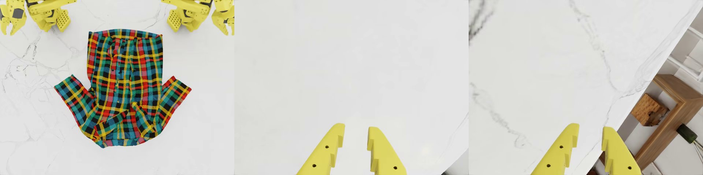

# Real robot: bimanual SO-101 followers on the Orin

From boxed arms to the policy folding a garment: build the rig, set up the Orin, calibrate, run.
Each phase ends with an acceptance test. Do not start the next phase until it passes.

Not every acceptance test below has been run on real arms and cameras. Values marked (sim) come from
the simulator's configuration: they are what the rig has to reproduce, so measure them on the rig
rather than trusting them.

The policy is `lejepa_d1_nosig` (step 12500), trained only in simulation. Whether it folds real
cloth is the open question this rig exists to answer.

Contents: [1 Hardware](#1-hardware) · [2 Software on the Orin](#2-software-on-the-orin) ·
[3 Calibration](#3-calibration) · [4 Inference](#4-inference) ·
[5 Leader arms and recording](#5-leader-arms-and-recording) ·
[6 Pre-flight checklist](#6-pre-flight-checklist) · [7 Known gaps](#7-known-gaps)

---

## 1. Hardware

### 1.1 What the policy expects

The policy sees three RGB cameras and 12 joint angles, and was trained on one scene geometry. The
closer the rig is to it, the smaller the gap the policy has to bridge.



*The three views at the first frame of a training episode, arms at the rest pose: top camera, left
wrist, right wrist. Your cameras should reproduce these pictures.*

The policy was trained on demonstrations from one configuration of the simulator and scored in a
slightly different one (garment 0.20 m in front of the base line, top camera 0.44 m in front and
0.56 m above the table). The pictures and the table below are from the training data. Aim for those
values; the scoring setup shows that a few centimetres do not matter.

| quantity (sim) | value |
|---|---|
| arms | 2 SO-101 followers side by side, facing the same way |
| base separation | 0.46 m centre to centre |
| work surface | the plane the arms are mounted on: the table top is the arm base plane |
| garment centre | 0.275 m in front of the base line, on the midline |
| top camera lens | on the midline, 0.50 m in front of the base line, 0.60 m above the table |
| top camera tilt | 19° from straight down, tilted back toward the arms |
| top camera view | 640 × 480, 30 fps, 67° horizontal × 53° vertical |
| top image layout | arm bases at the top edge; the right arm appears on the left of the image |
| table seen by the top camera | about 0.84 m wide, from 0.11 m behind the base line to 0.58 m in front |
| wrist cameras | one per gripper, 640 × 480, 30 fps, 53.5° horizontal × 41° vertical, looking along the gripper with both fingers at the bottom centre of the image |
| surface | white, matte (the simulator's is white marble) |
| garments | 4 types (long/short-sleeve top, long/short pants), child-sized: a long-sleeve top is about 28 cm wide, 42 cm long and 50 cm across the sleeves |
| start pose | `shoulder_pan ∓1.236`, `shoulder_lift −1.71`, `elbow_flex 1.50`, `wrist_flex 1.05`, `wrist_roll −0.085`, `gripper −0.012` rad |
| action timing | one action per 1/90 s physics step, joints limited to 10 rad/s, so at most 0.111 rad per action |

Sources: the simulator configs (`garment_bi_cfg.py`, `garment_bi_cfg_v2.py`,
`particle_garment_cfg.yaml`) and the first frame of every training episode. The top camera's 67° is
horizontal; the 78° in the simulator config's comment is the diagonal.

The simulator's top camera also renders depth and LeHome's dataset schema has a depth channel, but
this policy reads RGB only. Any UVC camera works, no RGB-D camera is needed.

### 1.2 Desk and mounting

- Table: rigid, with at least 1.0 m (wide) × 0.8 m (deep) of clear top: the arm bases at the back
  edge, about 0.6 m of work surface in front of them. A table that flexes when an arm moves shakes
  all three cameras.
- Surface: white or light, matte, uniform. Avoid glossy tops (highlights move with the arms) and
  patterns the size of a garment. A sheet of white matte board or cloth-backed vinyl taped flat is
  enough.
- Arms: clamp both bases to the same edge, 0.46 m between base centres, parallel, facing the work
  surface. Measure the separation, and mark the base outlines on the table so a bumped arm can go
  back. Left and right are the robot's own: standing behind the arms and looking at the work
  surface, the left arm is on your left.
- Top camera: a mast or boom that puts the lens on the midline, 0.50 m in front of the base line and
  0.60 m above the table, tilted 19° back toward the arms, with the top of the image toward the
  arms. Mount it from the far side of the table or from above, since an upright between the arms and
  the cloth gets hit. It must not move when the table is bumped: the policy has never seen camera
  shake.
- Wrist cameras: one per gripper on the standard SO-101 wrist-camera mount, looking forward along
  the gripper so that both fingers enter the frame from the bottom centre. Route the cable along the
  arm with slack at every joint (wrist roll turns ±160°). A snagged cable is an overload fault.
- Lighting: bright, diffuse, from above. No window behind the cameras' view and no hard shadow of
  the arms on the cloth. The simulator's white table reads about 220 of 255, while in ordinary room
  light a wrist camera at 30 fps renders it at 80 to 110, so add light rather than gain.
  `so101-smolvla-edge cameras` prints each camera's mean brightness, the share of clipped white, and
  the reference's brightness.
- Camera controls: autofocus, automatic frame-rate reduction and leftover gain or gamma settings all
  change the picture behind your back. An autofocus camera can focus much worse than a fixed
  setting, cameras sold as identical can differ in stored gain and gamma, and a camera in dim light
  can drop to 15 fps until dynamic frame rate is turned off.
  `so101-smolvla-edge cameras CONFIG --controls` lists what each camera accepts. Pin what matters
  under `controls:` in the config (applied at every start), e.g. `"Focus, Automatic Continuous": 0`,
  `"Focus, Absolute": 208`, `"Exposure, Dynamic Framerate": 0`. Prefer a camera with manual exposure
  control: without it nothing stops the camera from clipping the white table when a garment fills
  the centre.
- Tone transform, for a camera that overexposes anyway: `gain:` and `gamma:` per camera apply
  `out = 255 * gain * (in/255) ** gamma` to every frame. Fit them on two surfaces whose simulator
  colour is known: the white table (225 of 255 in the simulator) fixes `gain`, and the yellow arms
  (214, 205, 93) fix `gamma`. One such fit gave `gain: 0.88`, `gamma: 2.0`. Clipped detail does not
  come back, and since the camera's auto exposure follows the garment, the fit drifts with what is
  on the table. Check what the transform does to the garment before keeping it: it once turned a
  light-blue T-shirt denim blue, and the policy then started the trousers fold instead of the
  T-shirt fold. The goal is the policy starting the right fold, not matching the table and the arms.
- Garment colour decides which fold the policy starts. Recolouring one real T-shirt in a saved
  frame: yellow, green, white and dark grey always started the T-shirt fold, red and pink nearly
  always, light blue and purple about half the time, and orange, mid grey and darker blue almost
  always started the trousers fold. Before trusting a garment, watch the first seconds after `go`:
  for a top, only the shoulders swing in for about 2 s (slow mode), then the right arm reaches
  alone.
- Identical cameras often report the same serial number. Use `/dev/v4l/by-path/` names and keep each
  camera in its port.
- Arm colour: the simulator's arms are yellow. Arms printed in another colour are a visual change
  the policy has not been tested against. Note it, do not repaint yet.

### 1.3 Cameras: field of view

A camera wider than the simulator's view is fine, the config crops it:

    crop = tan(sim_hfov / 2) / tan(camera_hfov / 2)

| camera's horizontal FOV | top (67°) | wrist (53.5°) |
|---|---|---|
| 60° | too narrow | 0.87 |
| 70° | 0.95 | 0.72 |
| 78° | 0.82 | 0.62 |
| 90° | 0.66 | 0.50 |

Set `crop:` per camera in the config (the fraction of the frame width kept), and set
`capture_width` / `capture_height` to a larger mode, e.g. 1280 × 960 or 1280 × 720, so the cropped
frame still has 640 × 480 of real pixels. The crop is always taken at the output's 4:3 shape, so
nothing is squashed. A 16:9 mode keeps at most 75 % of its width, which already counts as `crop: 0.75`.

A camera narrower than the simulator's view cannot be fixed: move it back (top) or choose another.
Avoid fisheye lenses (wider than about 100°), since the crop formula assumes a rectilinear image. If
you do not know a camera's FOV, measure it: put a ruler across the frame at a known distance, then
`hfov = 2·atan(visible_width / (2·distance))`.

### 1.4 Electrical

- Servo supply: one PSU per arm, for the servo voltage your kit has. Check the label: the STS3215
  comes in 7.4 V and 12 V versions. The Waveshare board's jumper must be on the B / USB channel.
  Set the `safety.voltage_min` / `voltage_max` band in the config to match: about 6.0 to 8.6 V for
  a 7.4 V kit, 10.5 to 13.5 V for a 12 V kit. The example's 6 to 14 V is deliberately loose.
- Emergency stop: no software e-stop is faster than your hand. Put the servo PSUs on one switched
  power strip within reach. Cutting power drops the arms: on an SO-101, torque off means the arm
  falls under gravity, so keep the work area clear of anything that would mind.
- USB: two serial adapters (one per arm) and three cameras. Use the Orin's own ports or a powered
  hub. Three MJPG 640 × 480 streams fit on one USB 2 bus, three uncompressed (YUYV) ones do not.
- Orin: its own PSU, not shared with the servos.

### 1.5 Acceptance test: the rig

1. The separation between base centres measures 0.46 m ± 0.5 cm, and both arms are parallel.
2. The top camera's lens is on the midline, 0.50 m in front of the base line and 0.60 m above the
   table (± 2 cm each), tilted 19° ± 2° (a phone inclinometer on the camera body).
3. With the arms hanging at rest and power off, nothing the arms can reach collides with the mast.

The camera images are checked in §2.4, once the software can take a snapshot.

---

## 2. Software on the Orin

The Orin (`chalk@192.168.1.38`, JetPack 7.2.1) is already set up. This section lists what is there,
how to check it, and how to rebuild it.

### 2.1 What is installed

| what | where |
|---|---|
| this repo, uv venv with torch 2.14.1+cu132 and JetPack's TensorRT linked in | `~/so101-smolvla-edge`, venv in `.venv` (`scripts/setup_jetson.sh`) |
| policy bundle, TensorRT plans (bf16, int8) and int8 calibration clips | `~/so101/bundles/nosig` (plans and clips in `trt/`) |
| compiled-kernel cache, only with `compile` on | `/media/chalk/8f4e…/so101/inductor` (`TORCHINDUCTOR_CACHE_DIR`) |
| LeRobot 0.6.1 and the Feetech SDK, for motor setup and calibration only | `/media/chalk/8f4e…/lerobot-bench` |
| logs and telemetry | `/media/chalk/8f4e…/telemetry`, `~/so101-logs` |

From scratch, in your home directory:
`git clone … && cd so101-smolvla-edge && scripts/setup_jetson.sh`. The script creates the uv venv in
`~/so101-smolvla-edge/.venv`. Then copy a bundle and build its TensorRT plans with
`so101-smolvla-edge build-trt <bundle> --precision bf16 int8`.

### 2.2 Every boot

```bash
sudo nvpmodel -m 2 && sudo jetson_clocks          # MAXN_SUPER, clocks locked (mode 0 is 15 W, GPU 612 MHz)
cat /sys/class/devfreq/17000000.gpu/min_freq      # must print 1020000000
cd ~/so101-smolvla-edge && source .venv/bin/activate
so101-smolvla-edge doctor                         # torch, CUDA, TensorRT, serial ports, cameras, groups
```

`jetson-clocks.service` is enabled, but the lock has been lost before, so check `min_freq` anyway;
`doctor` says whether the clock is pinned. Unlocked clocks show up as a slow `infer p50` (§4.3).

The policy loads in a few seconds: the default Triton kernels and the TensorRT plans need no compile
step. With `compile` on, start-up depends on the compiled-kernel cache instead: `inference.kernel_cache`
names its directory and `run` prints how many files it holds. A warm cache loads in about a minute,
an empty one compiles and autotunes for about six.

### 2.3 The config

```bash
cp configs/bimanual.example.yaml ~/so101/robot.yaml
ls -l /dev/serial/by-path/        # one entry per arm adapter: unplug one to see which is which
ls -l /dev/v4l/by-path/           # use the *-video-index0 entries; unplug to identify
```

Fill in `bundle`, the two `arms.*.port`, the two `calibration` files (§3), the three camera devices,
the voltage band, and each camera's `crop`. Use the `by-path` names: the CH343 adapters often share
a serial number, and `ttyACM0/1` swap between boots.

The example config runs `vision: trt`, `trt_precision: int8` and the default kernels. For the first
real sessions set `trt_precision: bf16`: the int8 engine's activation clips were calibrated on
simulator frames and have not been checked on real camera images. A fine-tuned bundle needs its own
TensorRT plan and also runs bf16.

### 2.4 Acceptance test: cameras

```bash
so101-smolvla-edge cameras ~/so101/robot.yaml --out ~/so101-logs/cameras
```

It prints each camera's delivered resolution, frame rate and mean brightness, and writes
`<camera>.jpg` and `<camera>_vs_reference.jpg` (live, simulator reference, and a 50 % blend side by
side). Copy them off the Orin and compare them with the pictures in §1.1. Pass when:

1. All three report 640 × 480 at 29 fps or more.
2. Top: both arm bases are at the top edge, inside the frame's top corners (set `flip: true` if they
   are at the bottom), and the work surface fills the rest. A garment laid collar toward the arms,
   0.275 m in front of the base line on the midline, sits at the image centre, and one 28 cm wide
   spans about a third of the image width (~210 px).
3. Wrists: both fingers enter from the bottom centre and reach about 30 % up the frame, as in the
   reference, with the table ahead of them.
4. Move the right arm by hand: it is the arm on the left of the top image.
5. Mean brightness is within about 20 % of the reference's on each camera, and stable over a minute.

If the scene looks right but too small or too large, adjust `crop`. If it is shifted, move the
camera.

---

## 3. Calibration

### 3.1 Why it matters

The policy outputs simulator joint angles in radians. `robot/calibration.py` converts them to servo
ticks through LeRobot's calibration file, in the `degrees` convention (the config's default, and the
one LeHome's own real-robot code used). A joint's angle is its true rotation from the midpoint of
the range you swept, at 4095 ticks per turn. So a simulator angle of 30° is 30° of real rotation,
and two things in the calibration decide whether the pose is right:

- The zero of each joint is the middle of its swept range, so reaching both mechanical stops
  matters. Stopping 10° short of one of them moves the zero by 5°.
- The reach: a simulator angle beyond the swept range is clamped at the stop.

The gripper is the exception. Its open-to-closed travel is mapped onto the simulator's gripper
range, because a gripper's ticks per degree depend on the horn.

### 3.2 Motors (once per arm)

If the arms came as kits or the IDs are not set, connect one arm's board and run this, one motor
connected at a time, as it prompts. `L` points at the LeRobot install from §2.1; the calibration
commands below use it too.

```bash
L=/media/chalk/8f4e3ae6-8c23-4afb-b9d8-025eef610b25/lerobot-bench/bin
$L/lerobot-setup-motors --robot.type=so101_follower --robot.port=/dev/serial/by-path/<left>
```

Then check each bus: all six IDs answer, model STS3215.

```bash
so101-smolvla-edge scan --port /dev/serial/by-path/<left> --ids 1-6
```

### 3.3 Calibrate (once per arm, and again after any re-assembly)

Torque is off during calibration, so hold the arm.

```bash
$L/lerobot-calibrate --robot.type=so101_follower --robot.port=/dev/serial/by-path/<left>  --robot.id=left
$L/lerobot-calibrate --robot.type=so101_follower --robot.port=/dev/serial/by-path/<right> --robot.id=right
```

1. *"Move to the middle of its range of motion"*: every joint mid-range, and wrist roll at its true
   neutral (the gripper jaws' plane as in LeRobot's calibration picture). Wrist roll has no stops
   and is recorded as a full turn, so this pose alone defines its zero.
2. *"Move all joints through their entire ranges"*: move every joint slowly to both mechanical
   stops, one at a time, including the gripper fully open and fully closed. Then press Enter. The
   stops define each joint's zero (§3.1), so do not stop short.

It writes the homing offsets and position limits into the servos and saves
`~/.cache/huggingface/lerobot/calibration/robots/so_follower/{left,right}.json`. Copy both to
`~/so101/calibration/` and point the config at them.

### 3.4 Reach and direction

```bash
so101-smolvla-edge calibration ~/so101/calibration/left.json ~/so101/calibration/right.json
```

For each joint it prints the swept range in ticks, the angles that range reaches (`reach deg`) and
the simulator's limits (`sim deg`). It flags any joint that misses a simulator limit by over 5°.

- A flagged joint: re-sweep it in `lerobot-calibrate`, since the usual cause is a stop not reached.
  If the arm truly cannot reach the angle, commands beyond it clamp. The policy rarely commands the
  limits, so note it and go on.
- A joint that moves the wrong way (§3.5, test 3) is not fixed by recalibrating, because LeRobot
  always writes `drive_mode: 0`. Set `"drive_mode": 1` for that joint in the JSON and re-check. The
  mapping honours it and the servo registers do not store it, so nothing needs rewriting.
- `stretched x` is for reference only: the factor by which the other convention
  (`convention: stretched`, each swept range mapped linearly onto the simulator's limits) would
  scale that joint. Wrist roll reads 1.125 there, which is why that convention is not the default.
  In `degrees` no JSON edit is needed.

### 3.5 Acceptance test: calibration

```bash
so101-smolvla-edge monitor ~/so101/robot.yaml    # read-only, torque untouched
```

1. It starts without a verification error. It compares the servos' registers with the files; an
   error means the wrong port, the wrong file, or a recalibration since the file was written.
2. Move one joint of the left arm by hand: only `left_*` values change, in the expected joint.
3. Pose both arms by hand like the rest-pose picture in §1.1: upper arm back, forearm forward and
   down, grippers closed, each arm turned outward. `monitor` should read near
   `shoulder_pan −1.24 / +1.24` (left / right), `shoulder_lift −1.71`, `elbow_flex +1.50`,
   `wrist_flex +1.05`, `wrist_roll −0.09`, `gripper −0.01`. An offset of more than about 0.15 rad on
   a joint means its zero is off (a stop not reached in the sweep, §3.1) or the left/right
   assignment is wrong. A reading that goes the wrong way when you move the joint is a direction
   flip (§3.4). This test is the check of the convention itself: if every joint of a carefully swept
   arm is off in the same pattern, stop and report it rather than tuning the files.
4. With a phone inclinometer or a printed protractor, move wrist roll and one large joint to a
   `monitor` reading of +1.571 rad. The physical angle from neutral is 90° ± 3°.
5. Voltage reads inside your band and temperatures are ambient.

---

## 4. Inference

### 4.1 First power-on with torque

Clear the table. Keep one hand on the PSU switch.

```bash
so101-smolvla-edge run ~/so101/robot.yaml --no-policy    # control loop and safety only, no model
```

Before `enable`, with torque still off, pose both arms by hand roughly like the rest-pose picture
(this is also §3.5, test 3). Then, at the console:

- `enable`: torque on, holding where the arms are. Support them until it holds.
- `status`, `pause`, `resume`.
- `home`: moves to the rest pose at 0.5 rad/s, in a straight line in joint space. From a pose near
  it nothing is in the way; from an arm lying on the table the path can drag across the surface.
- `quit`: leaves the arms holding with torque on.
- `off`: asks for `YES`, then drops the arms.

Then do the same with `--fake-policy` (a small sinusoid around the current pose). It checks the
executor, slew limits and logs on real servos before the model is involved.

### 4.2 First policy run

For the first session, slow the motion down: set `inference.action_dt: 0.1`, leave
`safety.max_velocity: auto`, and keep `control.enable_on_start: false`.

`action_dt` and the slew limit belong together. In the simulator the arms chased each action at a
fixed rate, at most 0.111 rad per action, and the policy learned from joint states that lag the
action by exactly that much. `auto` sets the slew limit to 0.111 rad per `action_dt`: 3.33 rad/s at
1/30 s, 1.11 rad/s at 0.1 s. Change one without the other and the arm lags more, or less, than
anything the policy has seen.

The normal setting, `action_dt: 0.0333`, is already slow motion. The simulator executed one action
per 1/90 s physics step with joints allowed 10 rad/s, which an STS3215 cannot do. At 1/30 s the same
actions need at most 3.33 rad/s, which the servos and the executor's slew limit can follow, so the
robot performs the simulated motion at a third of its speed: a fold takes about 5 to 12 s instead of
the simulator's 2 to 4 s, and 15 to 35 s at `action_dt: 0.1`. Do not set 1/90: the arms would lag
every chunk by a factor of three and trip the tracking and chunk-plausibility checks. Cloth moved
three times slower does not behave the same (less swing, more drag), which is one of the sim-to-real
differences to watch for.

Each chunk is executed almost to its end (`inference.replan_actions: 45` of 50), as in the simulator
evaluation, which ran all 50 actions before looking again. Replanning every few actions looks more
reactive but is worse: this policy's chunks often begin by holding still and move later, so an arm
that only executes the start of each chunk dithers in place and never gets to the motion.

What `go` does first: both arms swing about 70 degrees inward. In every training episode the first
action already has the shoulder pans near zero (over the table) while the arms are still at rest,
turned outward. That is a 1.2 to 1.8 rad step, taken at the slew limit. It is the policy working,
not a fault. Keep the area in front of the arms clear before `go`.

```bash
so101-smolvla-edge verify ~/so101/bundles/nosig --vision trt --trt-precision bf16   # must PASS on this device
so101-smolvla-edge run ~/so101/robot.yaml
```

1. `enable`, then `home`. Wait until the arms are at the rest pose.
2. Lay one garment flat, centred about 0.275 m in front of the base line, like the reference
   picture.
3. If anything moved since §2.4, run `so101-smolvla-edge cameras` in a second terminal before `go`.
4. `go`. Watch the status line: `infer p50` should be about 130 ms (bf16) or 111 ms (int8),
   `chunks ok` climbing, `rej` rare.
5. `pause` at any doubt, `resume` to continue, `home` between episodes.

### 4.3 What a healthy run looks like, and what the faults mean

| you see | meaning | do |
|---|---|---|
| `chunks ok` rising, `rej` rare | normal | nothing |
| many `rej`: *chunk starts too far from the current command* | consecutive chunks disagree by more than 2.0 rad: the slew limit does not match `action_dt` (set `max_velocity: auto`), or the policy is unsure of the scene (camera view, lighting, garment out of place). If it says *entering from rest* on every chunk, `control.max_first_jump` is below the 2.0 rad the dataset needs | `pause`, look at `chunks.jsonl` (each chunk's `state`, `first` and `last` action), then re-check §2.4 |
| `FAULT … overload`, hold | a joint pushed 90 % load or more for 0.3 s: collision, cable snag, cloth caught | clear it, `resume` |
| `FAULT … tracking`, hold | command and measured position more than 0.6 rad apart for 0.5 s | check that the joint moves freely, and the voltage |
| `FAULT … temperature`, that arm's torque off | 68 °C | let it cool. The arm dropped, so reset the scene, then `enable` |
| arms tremble in place and make no progress | too little of each chunk is executed before replanning | `inference.replan_actions: 45` (not a small `replan_period_s`) |
| inference skipped: stale camera frame | a camera stopped delivering | cable or hub power; `so101-smolvla-edge cameras` |
| `infer p50` ≥ 160 ms | GPU clocks unlocked | §2.2 |

Every hold applies to both arms and latches until `resume`. The full table is in the README
("Safety").

### 4.4 Logs and the live view

Each run writes `<log_dir>/<timestamp>/`:

- `ticks.csv`: 100 Hz per arm, with target, written goal, measured position, velocity, load,
  current, temperature and voltage.
- `chunks.jsonl`: per inference, the latency, whether it was accepted (or why not), the state it
  saw, and its first and last action.
- `events.jsonl`: state changes, faults, operator commands.
- `config.json`.
- `inputs/<seq>_<camera>.jpg`: the three frames each inference was given, after cropping and
  flipping. This is what the policy saw. `log_inputs` controls it (on by default); it is three small
  files per chunk.

Set `log_dir` (or `SO101_LOG_DIR`) to the NVMe telemetry directory. Whole episodes at 30 fps are
recorded only with `--record` (§5).

To watch live from another machine, use Rerun: `pip install rerun-sdk` at the robot's version on the
viewing machine, or use a browser.

```bash
so101-smolvla-edge run ~/so101/robot.yaml --rerun        # robot; or viz.rerun: true in the config
rerun --connect rerun+http://<robot>:9876/proxy          # viewer; the robot prints this line and a browser URL
```

The view shows, on one time axis, the frames the model was given at each inference (top row), the
live cameras at 5 Hz, each joint's planned actions against the goal written and the position
measured, and the event log. When the policy does something odd, look at the top row first: it is
the model's whole knowledge of the scene. The stream is cheap and never on the control path.

### 4.5 Acceptance test: inference

1. `--no-policy` and `--fake-policy` runs: 10 minutes each, no fault, `loop` ≈ 10.0 ms, `miss 0`.
2. Policy run at `action_dt: 0.1`: the arms move toward the garment, chunks are accepted, and there
   is no fault in three consecutive episodes.
3. Only then set `action_dt` back to 0.0333, and only after that score and record episodes.

---

## 5. Leader arms and recording

Not needed until §4.5 passes. Recording works without leaders; demonstrations and takeovers need
them.

### 5.1 Recording

```bash
so101-smolvla-edge run ~/so101/robot.yaml --record    # or record.enabled: true
```

Set `record.dir` (or `SO101_DATA_DIR`) to the NVMe: three cameras write about 4 MB/s. An episode
starts at `go` (or `take`) and ends when you type its verdict:

| command | effect |
|---|---|
| `save [note]` (or `ok`) | hold, write the episode with label `success` |
| `fail [note]` | hold, write it with label `fail` |
| `discard` | hold, delete it |

`<record.dir>/<session>/episode_NNNN/` holds one JPEG per camera per frame at 30 fps, `steps.npz`
(joint positions, the goal written to the servos, and who was driving: policy, leaders, holding,
fault, or the ramp at the start of a takeover) and `episode.json` (label, note, frame counts). Use
the note for the garment and anything odd: `save shirt 3`, `fail shirt 5 dropped left sleeve`.
Recording leaves the control loop unchanged and does not drop frames.

### 5.2 Leader arms

Calibrate each leader exactly like a follower (§3.3), with the leader type:

```bash
$L/lerobot-calibrate --teleop.type=so101_leader --teleop.port=/dev/serial/by-path/<leader-left>  --teleop.id=left
$L/lerobot-calibrate --teleop.type=so101_leader --teleop.port=/dev/serial/by-path/<leader-right> --teleop.id=right
```

The files land in `~/.cache/huggingface/lerobot/calibration/teleoperators/so_leader/`. Copy them to
`~/so101/calibration/so101_leader_{left,right}.json` and uncomment `leaders:` in the config. The
leaders are only read: the process never enables their torque. `so101-smolvla-edge calibration`
reports their reach too.

### 5.3 Demonstrations and takeovers

| command | from | effect |
|---|---|---|
| `take` (or `t`) | holding, or the policy running | the followers track the leaders |
| `take 5` | same | the same after a 5 s countdown that prints the leader gap each second, then a bell |
| `go` | leaders driving | hand back to the policy |
| `pause` | either | hold |

- Before `take`, pose the leaders like the followers. The status line shows `leader gap`, the
  largest joint difference and which joint. Under 0.15 rad the takeover is seamless. Up to 1.0 rad
  the followers first close the gap at 1 rad/s, and those frames are recorded as a ramp, never as
  your action. Beyond 1.0 rad `take` is refused and names the joint.
- Working alone, both hands are on the leaders and none is on the keyboard. A leader let go in
  mid-air sags, and its follower follows it. So leave the leaders parked at the rest pose, where
  they stay put. To take over, type `pause` (the followers hold where they are), then `take 5`, and
  use the countdown to bring the leaders to the followers' pose. To end, bring both arms back to the
  rest pose, let go, then type `save`. With a second person at the keyboard, plain `take` works at
  any moment.
- A demonstration: `home`, place the garment, `take 5` (or `take`), fold, park, `save <garment>`.
- A correction: `go` and watch. The moment the policy goes wrong, `pause`, `take 5`, finish the fold
  yourself, park, `save <garment>`. If it folds on its own, `save <garment>` without taking over.
- End the episode as soon as the fold is done. Under the policy, whatever it does between the fold
  and your `save` is recorded as its behaviour. `pause` first if you need a moment; held frames are
  never used.
- The followers obey the same velocity, load and limit checks as under the policy. If the leaders
  stop reporting (cable, power), the followers hold.

### 5.4 Acceptance test: leaders and recording

1. With `leaders:` configured and torque off, start `so101-smolvla-edge run … --no-policy`. The
   status line shows a `leader gap`. Pose a leader like its follower: the gap falls below 0.15 rad.
   Move one leader joint: the gap names that joint. A leader joint that reads the wrong way gets
   `drive_mode: 1` (§3.4).
2. `enable`, `take`: the followers mirror the leaders, joint for joint and in the same direction.
   Opening a leader's gripper opens its follower's.
3. `take`, move for ten seconds, `save test`: the episode directory has about 300 frames per camera,
   `episode.json` says `dropped: 0`, and the JPEGs show what the cameras saw.

---

## 6. Pre-flight checklist

Before every session:

- [ ] `min_freq` reads 1020000000 and `nvpmodel -q` says MAXN_SUPER
- [ ] `inference.kernel_cache` is set in the config and `run` reports the cache is not empty
  (otherwise a start takes about 6 min)
- [ ] `so101-smolvla-edge doctor`: two serial ports, three cameras
- [ ] arm bases on their marks, top camera untouched, `so101-smolvla-edge cameras` matches the last
  good snapshots
- [ ] `so101-smolvla-edge monitor`: no verification error, voltage in band, temperatures below 40 °C
- [ ] table clear, PSU switch within reach, wrist-camera cables free through full wrist roll
- [ ] `enable`, then `home`, then place the garment, then `go`
- [ ] recording: `record.dir` on the NVMe with space left (about 4 MB/s), leaders posed like the
  followers before `take`

## 7. Known gaps

- Hardware: not every step on this page has been run on real arms and cameras. Expect the first
  sessions to change it.
- Calibration convention: `degrees` is what LeHome's real-robot code used and what a
  simulator-trained policy needs, but it has not been checked on these arms. §3.5 tests 3 and 4 are
  that check.
- Timing: the robot runs the policy at a third of the simulator's speed (§4.2). The effect on cloth
  is unmeasured.
- Leader takeover and recording have run only against simulated servos and replayed frames.
- int8 vision on real images is uncalibrated (§2.3).
- Wrist-camera pose: the simulator's mount is an offset of (−0.001, 0.1, −0.04) on the gripper
  link, and the real mount is whatever reproduces the reference picture. If the standard mount
  cannot, a printed adapter is needed.
- Arm colour, table texture, garment size and fabric are all unmatched variables. The policy's
  robustness to garment texture was measured in simulation only.
- Garment size: the simulator's garments are child-sized (§1.1), the top camera sees about
  0.84 × 0.69 m of table, and an SO-101 reaches roughly 0.4 m from its base. An adult T-shirt
  (about 50 cm wide, 70 cm long) fits neither the view nor the reach.
